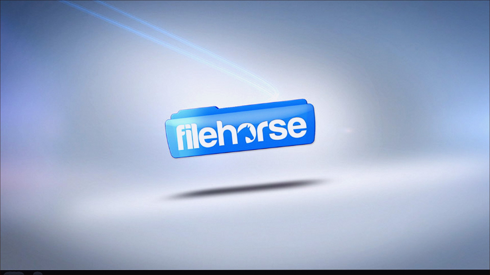
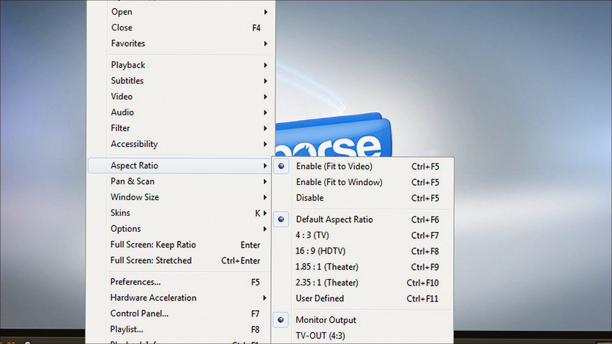
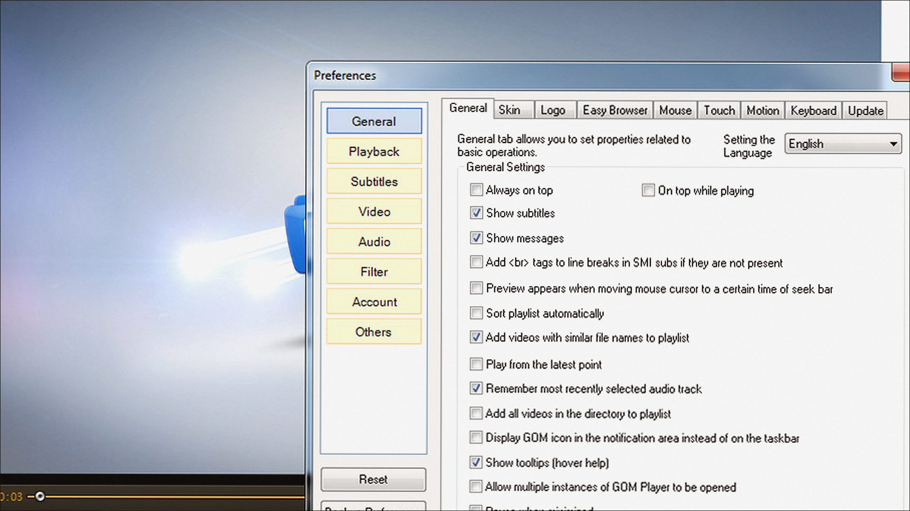

# Windows notes: GOM Player

**GOM & Company** · 2.3 · 213 MB · Video catalog

[Open card](https://moggydayprogram.com/programs/gom-player) · [English](https://moggydayprogram.com/en/programs/gom-player) · [GitHub Pages](https://laserbetweenmap.github.io/gom-player-windows/?lang=en)

  
  
  

Плеер с поиском субтитров. Бесплатно, русский.

GOM Player on Windows 10/11 x64. 213 MB. Requirements, screenshots, MoggyDay Launcher.

Get it from the catalog card, not from this repository.

| Field | Value |
| --- | --- |
| Build | 2.3 Global |
| OS | Windows 10/11 x64 |
| Pages | https://laserbetweenmap.github.io/gom-player-windows/ |

- [VLC media player](https://moggydayprogram.com/programs/vlc)
- [PotPlayer](https://moggydayprogram.com/programs/potplayer)
- [KMPlayer](https://moggydayprogram.com/programs/kmplayer)
